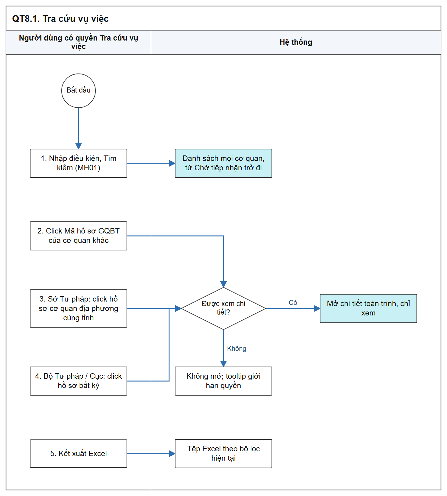

# Tra cứu vụ việc - Sơ đồ luồng các bước

[Tổng quan - Sơ đồ luồng nghiệp vụ BTNN - Tài liệu tổng hợp](00_Tong_quan_luong_BTNN.md)

## 1. Mục đích và điểm vào

- Tra cứu vụ việc bồi thường nhà nước toàn hệ thống trên 01 danh sách; xem chi tiết toàn trình ở chế độ chỉ xem; kết xuất Excel.
- Không có thêm mới, cập nhật, trình duyệt, ký duyệt.
- Menu: `Bồi thường nhà nước` > `Tra cứu vụ việc`.
- Mockup: [tra_cuu_ho_so_boi_thuong.html](https://huyendt2007.github.io/BPBD_UI/UI_Mockup/Website_Quan_tri/03_Boi_thuong_nha_nuoc/tra_cuu_ho_so_boi_thuong.html).
- SRS: [Tra cứu vụ việc - Công tác bồi thường nhà nước (Website Quản trị)](../../03_Website_Quan_tri/03_Cong_tac_boi_thuong/SRS_BTNN_GiaiQuyetBT_TraCuu_VuViec.md).

## 2. Sơ đồ luồng các bước

- Bản SVG để phóng to: [08_1_tra_cuu.svg](images/08_1_tra_cuu.svg)

## 3. Bảng các bước

| STT | Người dùng giả lập gợi ý | Màn hình | Thao tác | Kết quả | Tham chiếu SRS |
| :-- | :--- | :--- | :--- | :--- | :--- |
| 1 | `cv_hm1` (UBND phường Bạch Mai) | MH01 | Tìm kiếm | Thấy vụ việc của mọi cơ quan | [Phạm vi danh sách - Tra cứu vụ việc - Công tác bồi thường nhà nước (Website Quản trị)](../../03_Website_Quan_tri/03_Cong_tac_boi_thuong/SRS_BTNN_GiaiQuyetBT_TraCuu_VuViec.md#tcvv-pham-vi-trang-thai) |
| 2 | `cv_hm1` | MH01 | Click Mã hồ sơ GQBT của cơ quan khác | Không mở; tooltip giới hạn quyền | [Phân quyền và phạm vi dữ liệu - Tra cứu vụ việc - Công tác bồi thường nhà nước (Website Quản trị)](../../03_Website_Quan_tri/03_Cong_tac_boi_thuong/SRS_BTNN_GiaiQuyetBT_TraCuu_VuViec.md#tcvv-pham-vi-du-lieu) |
| 3 | `cv_hn1` (Sở Tư pháp Hà Nội) | MH01 | Click hồ sơ của cơ quan Địa phương cùng tỉnh | Mở chi tiết chỉ xem | [Quyền xem chi tiết - Tra cứu vụ việc - Công tác bồi thường nhà nước (Website Quản trị)](../../03_Website_Quan_tri/03_Cong_tac_boi_thuong/SRS_BTNN_GiaiQuyetBT_TraCuu_VuViec.md#tcvv-quyen-xem-chi-tiet) |
| 4 | `canbonv` (Bộ Tư pháp) | MH01 | Click mọi hồ sơ | Mở chi tiết | Cùng mục trên |
| 5 | Bất kỳ | MH01 | `Kết xuất Excel` | Tải danh sách theo bộ lọc | [Phân quyền và phạm vi dữ liệu - Tra cứu vụ việc - Công tác bồi thường nhà nước (Website Quản trị)](../../03_Website_Quan_tri/03_Cong_tac_boi_thuong/SRS_BTNN_GiaiQuyetBT_TraCuu_VuViec.md#tcvv-pham-vi-du-lieu) |

## 4. Trạng thái

- Không có trạng thái riêng; hiển thị Trạng thái vụ việc của Giải quyết YCBT.
- Phạm vi: 19 trạng thái từ `Chờ tiếp nhận` trở đi, không có `Dừng giải quyết` trong danh sách phạm vi ([Phạm vi danh sách - Tra cứu vụ việc - Công tác bồi thường nhà nước (Website Quản trị)](../../03_Website_Quan_tri/03_Cong_tac_boi_thuong/SRS_BTNN_GiaiQuyetBT_TraCuu_VuViec.md#tcvv-pham-vi-trang-thai)).

## 5. Liên thông

| Chiều | Phân hệ | Dữ liệu |
| :--- | :--- | :--- |
| Vào | Giải quyết YCBT, Quyết định GQBT, Kinh phí | Dữ liệu vụ việc và tiến trình |

## 6. Điểm cần lưu ý khi kiểm thử

- `Cơ quan giải quyết` là cơ quan hiện hành; vụ việc `Đã chuyển CQGQBT` tính theo cơ quan nhận chuyển ([Quyền xem chi tiết - Tra cứu vụ việc - Công tác bồi thường nhà nước (Website Quản trị)](../../03_Website_Quan_tri/03_Cong_tac_boi_thuong/SRS_BTNN_GiaiQuyetBT_TraCuu_VuViec.md#tcvv-quyen-xem-chi-tiet)).
- Mở bằng đường dẫn chứa `Mã hồ sơ GQBT` khi không có quyền: không mở chi tiết, hiển thị nội dung tooltip (cùng mục trên).
- Sở Tư pháp chỉ xem chi tiết hồ sơ của cơ quan có `Cấp đơn vị` `Địa phương` cùng `Tỉnh/Thành phố` (cùng mục trên).
- Điểm cần BA xác nhận: danh sách phạm vi không có trạng thái `Dừng giải quyết` dù Giải quyết YCBT có 20 trạng thái.
