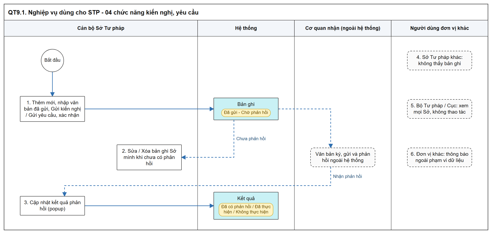
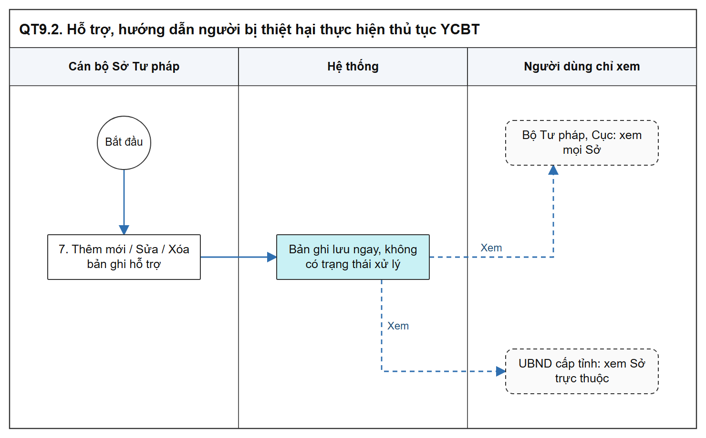

# Nghiệp vụ dùng cho STP - Sơ đồ luồng các bước

[Tổng quan - Sơ đồ luồng nghiệp vụ BTNN - Tài liệu tổng hợp](00_Tong_quan_luong_BTNN.md)

## 1. Mục đích và điểm vào

- Sở Tư pháp ghi nhận, theo dõi văn bản kiến nghị / yêu cầu đã gửi và các trường hợp hỗ trợ người bị thiệt hại; hệ thống không gửi văn bản.
- Menu: `Bồi thường nhà nước` > `Nghiệp vụ dùng cho STP`.
- Phạm vi dữ liệu chung: [Quy tắc Phạm vi dữ liệu Bộ Tư pháp - Sở Tư pháp - Danh mục và Phụ lục - Tài liệu tổng hợp](../04_Danh_muc_va_Phu_luc.md#quy-tac-pham-vi-du-lieu-btp-stp).

| Chức năng | SRS | Mockup |
| :--- | :--- | :--- |
| Kiến nghị cơ quan có thẩm quyền xử lý vi phạm | [Kiến nghị xử lý vi phạm - Công tác bồi thường nhà nước (Website Quản trị)](../../03_Website_Quan_tri/03_Cong_tac_boi_thuong/SRS_BTNN_STP_KienNghi_XuLyViPham_GQBT.md) | [module=kien_nghi_xu_ly_vi_pham](https://huyendt2007.github.io/BPBD_UI/UI_Mockup/Website_Quan_tri/03_Boi_thuong_nha_nuoc/quan_ly_nghiep_vu_btnn_muc6.html?module=kien_nghi_xu_ly_vi_pham) |
| Kiến nghị người có thẩm quyền kháng nghị bản án | [Kiến nghị kháng nghị bản án - Công tác bồi thường nhà nước (Website Quản trị)](../../03_Website_Quan_tri/03_Cong_tac_boi_thuong/SRS_BTNN_STP_KienNghi_KhangNghi_BanAn.md) | [module=kien_nghi_khang_nghi_ban_an](https://huyendt2007.github.io/BPBD_UI/UI_Mockup/Website_Quan_tri/03_Boi_thuong_nha_nuoc/quan_ly_nghiep_vu_btnn_muc6.html?module=kien_nghi_khang_nghi_ban_an) |
| Yêu cầu Thủ trưởng cơ quan hủy quyết định GQBT | [Yêu cầu hủy quyết định GQBT - Công tác bồi thường nhà nước (Website Quản trị)](../../03_Website_Quan_tri/03_Cong_tac_boi_thuong/SRS_BTNN_STP_YeuCau_Huy_QuyetDinh_GQBT.md) | [module=yeu_cau_huy_qd_gqbt](https://huyendt2007.github.io/BPBD_UI/UI_Mockup/Website_Quan_tri/03_Boi_thuong_nha_nuoc/quan_ly_nghiep_vu_btnn_muc6.html?module=yeu_cau_huy_qd_gqbt) |
| Kiến nghị Thủ trưởng cơ quan xem xét lại quyết định hoàn trả | [Kiến nghị xem xét lại quyết định hoàn trả - Công tác bồi thường nhà nước (Website Quản trị)](../../03_Website_Quan_tri/03_Cong_tac_boi_thuong/SRS_BTNN_STP_KienNghi_XemXet_QDHoanTra.md) | [module=kien_nghi_xem_xet_qd_hoan_tra](https://huyendt2007.github.io/BPBD_UI/UI_Mockup/Website_Quan_tri/03_Boi_thuong_nha_nuoc/quan_ly_nghiep_vu_btnn_muc6.html?module=kien_nghi_xem_xet_qd_hoan_tra) |
| Hỗ trợ, hướng dẫn người bị thiệt hại thực hiện thủ tục YCBT | [Hỗ trợ người bị thiệt hại - Công tác bồi thường nhà nước (Website Quản trị)](../../03_Website_Quan_tri/03_Cong_tac_boi_thuong/SRS_BTNN_DungChung_BTP_STP_HoTro_YCBT.md) | [module=ho_tro_nguoi_bi_thiet_hai](https://huyendt2007.github.io/BPBD_UI/UI_Mockup/Website_Quan_tri/03_Boi_thuong_nha_nuoc/quan_ly_nghiep_vu_btnn_muc6.html?module=ho_tro_nguoi_bi_thiet_hai) |

## 2. Sơ đồ luồng các bước

### 2.1. 04 chức năng kiến nghị, yêu cầu

- Bản SVG để phóng to: [09_1_kien_nghi.svg](images/09_1_kien_nghi.svg)

### 2.2. Hỗ trợ, hướng dẫn người bị thiệt hại

- Bản SVG để phóng to: [09_2_ho_tro.svg](images/09_2_ho_tro.svg)

## 3. Bảng các bước

| STT | Người dùng giả lập gợi ý | Màn hình | Thao tác | Kết quả / Trạng thái sau | Tham chiếu SRS |
| :-- | :--- | :--- | :--- | :--- | :--- |
| 1 | `cv_hn1` (Sở Tư pháp Hà Nội) | Danh sách kiến nghị | `Thêm mới`, nhập, `Gửi kiến nghị`, xác nhận | `Đã gửi - Chờ phản hồi` | [Kiến nghị kháng nghị bản án - Công tác bồi thường nhà nước (Website Quản trị)](../../03_Website_Quan_tri/03_Cong_tac_boi_thuong/SRS_BTNN_STP_KienNghi_KhangNghi_BanAn.md) |
| 2 | `cv_hn1` | Danh sách | Sửa / Xóa bản ghi `Đã gửi - Chờ phản hồi` của Sở mình | Lưu / xóa sau xác nhận | Cùng SRS |
| 3 | `cv_hn1` | Popup Cập nhật kết quả phản hồi | Cập nhật phản hồi | `Đã có phản hồi` / `Đã thực hiện` / `Không thực hiện` | Cùng SRS |
| 4 | `cv_hcm1` (Sở Tư pháp Hồ Chí Minh) | Danh sách | Tra cứu | Không thấy bản ghi của Sở Tư pháp Hà Nội | [Quy tắc Phạm vi dữ liệu Bộ Tư pháp - Sở Tư pháp - Danh mục và Phụ lục - Tài liệu tổng hợp](../04_Danh_muc_va_Phu_luc.md#quy-tac-pham-vi-du-lieu-btp-stp) |
| 5 | `canbonv` (Bộ Tư pháp) | Danh sách | Tra cứu, xem chi tiết | Thấy mọi Sở Tư pháp; nút thao tác mờ; không có `Thêm mới` | Cùng mục trên |
| 6 | `cv_hm1` (UBND phường) | Danh sách | Mở chức năng | Bảng 01 dòng "Đơn vị của người dùng không thuộc phạm vi dữ liệu của chức năng này." | Cùng mục trên |
| 7 | `cv_hn1` | Hỗ trợ người bị thiệt hại | Thêm mới, Sửa, Xóa | Bản ghi lưu ngay, không có trạng thái xử lý | [Hỗ trợ người bị thiệt hại - Công tác bồi thường nhà nước (Website Quản trị)](../../03_Website_Quan_tri/03_Cong_tac_boi_thuong/SRS_BTNN_DungChung_BTP_STP_HoTro_YCBT.md) |

## 4. Trạng thái

| Chức năng | Trạng thái |
| :--- | :--- |
| 04 chức năng kiến nghị, yêu cầu | `Đã gửi - Chờ phản hồi`, `Đã có phản hồi`, `Đã thực hiện`, `Không thực hiện`; form thêm mới hiển thị nhãn `Đang nhập` |
| Hỗ trợ người bị thiệt hại | Không có trạng thái |

## 5. Liên thông

- Không liên thông dữ liệu tự động với phân hệ xử lý vụ việc trong các SRS này; văn bản gửi và phản hồi nhận ngoài hệ thống.

## 6. Điểm cần lưu ý khi kiểm thử

- Sửa, Xóa chỉ với bản ghi `Đã gửi - Chờ phản hồi` (chưa cập nhật phản hồi) do Sở mình tạo (theo Mục đích của từng SRS kiến nghị).
- Thêm mới nhóm `Nghiệp vụ dùng cho STP`: chỉ người dùng thuộc Sở Tư pháp; UBND cấp tỉnh chỉ xem ([Quy tắc Phạm vi dữ liệu Bộ Tư pháp - Sở Tư pháp - Danh mục và Phụ lục - Tài liệu tổng hợp](../04_Danh_muc_va_Phu_luc.md#quy-tac-pham-vi-du-lieu-btp-stp)).
- Cột `Cán bộ xử lý` (người tạo) và `Đơn vị thực hiện` hệ thống tự ghi nhận, không sửa được; bộ lọc `Đơn vị thực hiện` dạng cây chọn nhiều (cùng mục trên).
- Thời hạn ban hành văn bản kiến nghị / thời hạn trả lời ghi trong Mục đích các SRS là căn cứ pháp lý; SRS không mô tả hệ thống tự tính hạn.
- Điểm cần BA xác nhận: `SRS_BTNN_DungChung_BTP_STP_HoTro_YCBT.md` đặt tên `DungChung` nhưng menu mockup và SRS đặt ở nhóm `Nghiệp vụ dùng cho STP`.
