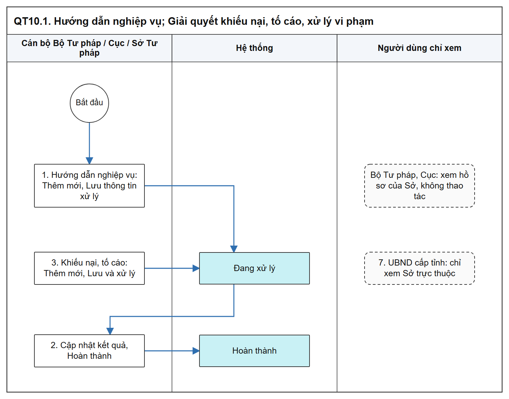
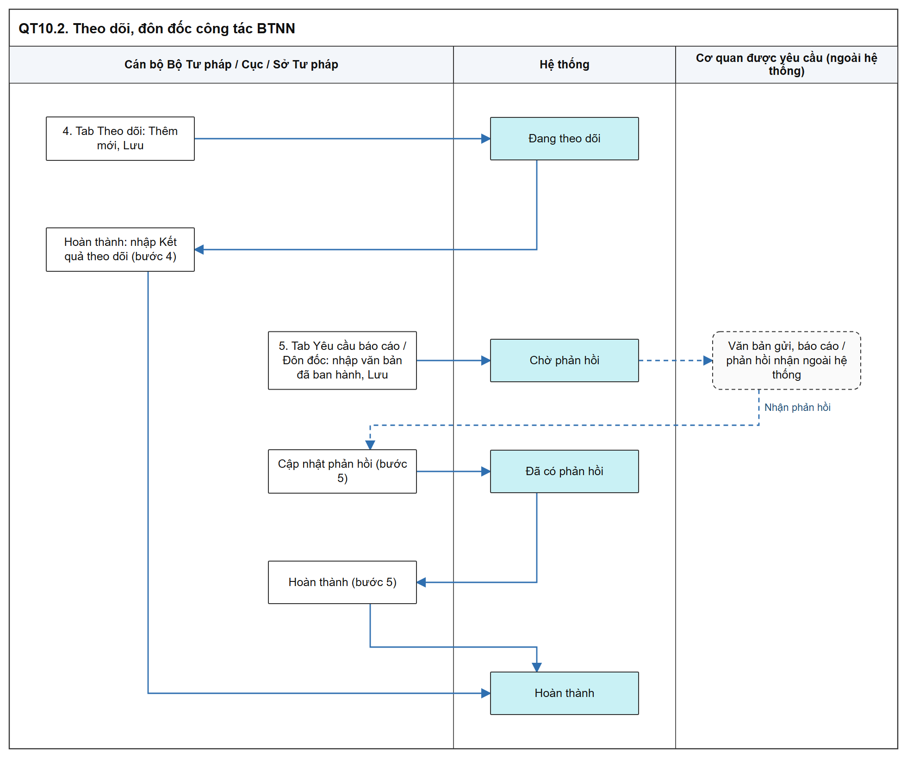
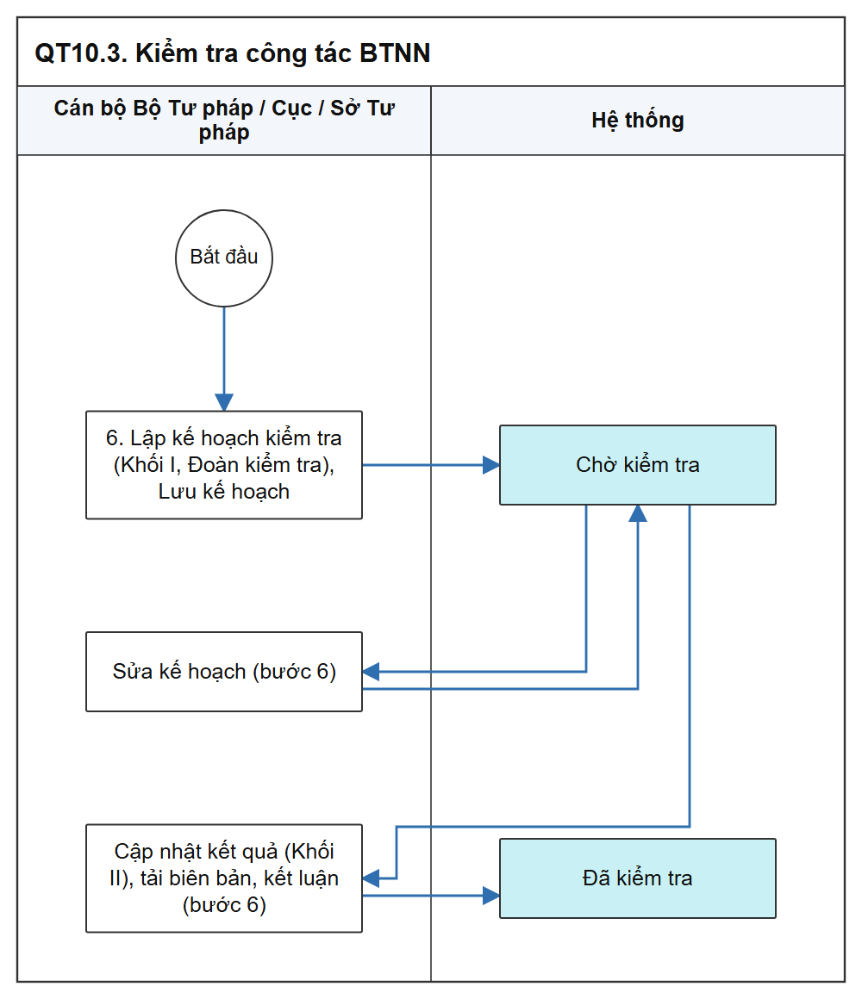

# Nghiệp vụ dùng chung BTP và STP - Sơ đồ luồng các bước

[Tổng quan - Sơ đồ luồng nghiệp vụ BTNN - Tài liệu tổng hợp](00_Tong_quan_luong_BTNN.md)

## 1. Mục đích và điểm vào

- Bộ Tư pháp / Cục và Sở Tư pháp nhập, quản lý thông tin quản lý nhà nước về công tác BTNN; văn bản ký, ban hành, gửi ngoài hệ thống, cán bộ tải tệp lên.
- Menu: `Bồi thường nhà nước` > `Nghiệp vụ dùng chung BTP & STP`.
- Phạm vi dữ liệu chung: [Quy tắc Phạm vi dữ liệu Bộ Tư pháp - Sở Tư pháp - Danh mục và Phụ lục - Tài liệu tổng hợp](../04_Danh_muc_va_Phu_luc.md#quy-tac-pham-vi-du-lieu-btp-stp).

| Chức năng | SRS | Mockup |
| :--- | :--- | :--- |
| Hướng dẫn, bồi dưỡng kỹ năng, nghiệp vụ | [Hướng dẫn nghiệp vụ - Công tác bồi thường nhà nước (Website Quản trị)](../../03_Website_Quan_tri/03_Cong_tac_boi_thuong/SRS_BTNN_DungChung_BTP_STP_HuongDan_NghiepVu.md) | [module=huong_dan](https://huyendt2007.github.io/BPBD_UI/UI_Mockup/Website_Quan_tri/03_Boi_thuong_nha_nuoc/quan_ly_nghiep_vu_btnn_tt08.html?module=huong_dan) |
| Theo dõi, đôn đốc công tác BTNN | [Theo dõi, đôn đốc công tác BTNN - Công tác bồi thường nhà nước (Website Quản trị)](../../03_Website_Quan_tri/03_Cong_tac_boi_thuong/SRS_BTNN_DungChung_BTP_STP_TheoDoi_DonDoc.md) | [quan_ly_theo_doi_don_doc_btnn.html](https://huyendt2007.github.io/BPBD_UI/UI_Mockup/Website_Quan_tri/03_Boi_thuong_nha_nuoc/quan_ly_theo_doi_don_doc_btnn.html) |
| Kiểm tra công tác BTNN | [Kiểm tra công tác BTNN - Công tác bồi thường nhà nước (Website Quản trị)](../../03_Website_Quan_tri/03_Cong_tac_boi_thuong/SRS_BTNN_DungChung_BTP_STP_KiemTra_CongTac.md) | [quan_ly_kiem_tra_cong_tac_btnn.html](https://huyendt2007.github.io/BPBD_UI/UI_Mockup/Website_Quan_tri/03_Boi_thuong_nha_nuoc/quan_ly_kiem_tra_cong_tac_btnn.html) |
| Giải quyết khiếu nại, tố cáo, xử lý vi phạm | [Giải quyết khiếu nại, tố cáo, xử lý vi phạm - Công tác bồi thường nhà nước (Website Quản trị)](../../03_Website_Quan_tri/03_Cong_tac_boi_thuong/SRS_BTNN_DungChung_BTP_STP_GiaiQuyet_KhieuNai_ToCao_XuLyViPham.md) | [module=khieu_nai](https://huyendt2007.github.io/BPBD_UI/UI_Mockup/Website_Quan_tri/03_Boi_thuong_nha_nuoc/quan_ly_nghiep_vu_btnn_tt08.html?module=khieu_nai) |

## 2. Sơ đồ luồng các bước

### 2.1. Hướng dẫn nghiệp vụ; Giải quyết khiếu nại, tố cáo, xử lý vi phạm

- Bản SVG để phóng to: [10_1_huong_dan_khieu_nai.svg](images/10_1_huong_dan_khieu_nai.svg)

### 2.2. Theo dõi, đôn đốc công tác BTNN

- Bản SVG để phóng to: [10_2_theo_doi_don_doc.svg](images/10_2_theo_doi_don_doc.svg)

### 2.3. Kiểm tra công tác BTNN

- Bản SVG để phóng to: [10_3_kiem_tra.svg](images/10_3_kiem_tra.svg)

## 3. Bảng các bước

| STT | Người dùng giả lập gợi ý | Màn hình | Thao tác | Kết quả / Trạng thái sau | Tham chiếu SRS |
| :-- | :--- | :--- | :--- | :--- | :--- |
| 1 | `canbonv` (Bộ Tư pháp) hoặc `cv_hn1` (Sở Tư pháp) | Hướng dẫn nghiệp vụ | Thêm mới, Lưu thông tin xử lý | `Đang xử lý` | [Hướng dẫn nghiệp vụ - Công tác bồi thường nhà nước (Website Quản trị)](../../03_Website_Quan_tri/03_Cong_tac_boi_thuong/SRS_BTNN_DungChung_BTP_STP_HuongDan_NghiepVu.md) |
| 2 | Như trên | Hướng dẫn nghiệp vụ | Hoàn thành xử lý | `Hoàn thành` | Cùng SRS |
| 3 | Như trên | Khiếu nại, tố cáo | Thêm mới, Lưu và xử lý, Cập nhật kết quả | `Đang xử lý` → `Hoàn thành` | [Giải quyết khiếu nại, tố cáo, xử lý vi phạm - Công tác bồi thường nhà nước (Website Quản trị)](../../03_Website_Quan_tri/03_Cong_tac_boi_thuong/SRS_BTNN_DungChung_BTP_STP_GiaiQuyet_KhieuNai_ToCao_XuLyViPham.md) |
| 4 | Như trên | Theo dõi, đôn đốc - tab Theo dõi | Thêm mới, Lưu; Hoàn thành | `Đang theo dõi` → `Hoàn thành` | [Theo dõi, đôn đốc công tác BTNN - Công tác bồi thường nhà nước (Website Quản trị)](../../03_Website_Quan_tri/03_Cong_tac_boi_thuong/SRS_BTNN_DungChung_BTP_STP_TheoDoi_DonDoc.md) |
| 5 | Như trên | Tab Yêu cầu báo cáo / Đôn đốc | Nhập văn bản; Cập nhật phản hồi; Hoàn thành | `Chờ phản hồi` → `Đã có phản hồi` → `Hoàn thành` | Cùng SRS |
| 6 | Như trên | Kiểm tra công tác BTNN | Lưu kế hoạch; Cập nhật kết quả | `Chờ kiểm tra` → `Đã kiểm tra` | [Kiểm tra công tác BTNN - Công tác bồi thường nhà nước (Website Quản trị)](../../03_Website_Quan_tri/03_Cong_tac_boi_thuong/SRS_BTNN_DungChung_BTP_STP_KiemTra_CongTac.md) |
| 7 | `ct_ubndhn` (UBND cấp tỉnh) | Mọi chức năng | Tra cứu | Chỉ xem bản ghi của Sở Tư pháp trực thuộc; không có `Thêm mới` | [Quy tắc Phạm vi dữ liệu Bộ Tư pháp - Sở Tư pháp - Danh mục và Phụ lục - Tài liệu tổng hợp](../04_Danh_muc_va_Phu_luc.md#quy-tac-pham-vi-du-lieu-btp-stp) |

## 4. Trạng thái

| Chức năng | Trạng thái |
| :--- | :--- |
| Hướng dẫn, bồi dưỡng kỹ năng, nghiệp vụ | `Đang xử lý`, `Hoàn thành` |
| Giải quyết khiếu nại, tố cáo, xử lý vi phạm | `Đang xử lý`, `Hoàn thành` |
| Theo dõi, đôn đốc - tab Theo dõi | `Đang theo dõi`, `Hoàn thành` |
| Theo dõi, đôn đốc - tab Yêu cầu báo cáo, Đôn đốc | `Chờ phản hồi`, `Đã có phản hồi`, `Hoàn thành` |
| Kiểm tra công tác BTNN | `Chờ kiểm tra`, `Đã kiểm tra`; form thêm mới hiển thị nhãn `Đang nhập` |

## 5. Liên thông

- Giải quyết khiếu nại, tố cáo: cho phép liên kết với vụ việc yêu cầu bồi thường, hồ sơ hoàn trả, hồ sơ theo dõi / đôn đốc hoặc hồ sơ kiểm tra ([Giải quyết khiếu nại, tố cáo, xử lý vi phạm - Công tác bồi thường nhà nước (Website Quản trị)](../../03_Website_Quan_tri/03_Cong_tac_boi_thuong/SRS_BTNN_DungChung_BTP_STP_GiaiQuyet_KhieuNai_ToCao_XuLyViPham.md)).
- Các chức năng khác chỉ ghi nhận, không gửi văn bản ra ngoài.

## 6. Điểm cần lưu ý khi kiểm thử

- Sửa, cập nhật, hoàn thành chỉ trên bản ghi do đơn vị mình tạo; Bộ Tư pháp / Cục không thao tác trên bản ghi của Sở Tư pháp ([Quy tắc Phạm vi dữ liệu Bộ Tư pháp - Sở Tư pháp - Danh mục và Phụ lục - Tài liệu tổng hợp](../04_Danh_muc_va_Phu_luc.md#quy-tac-pham-vi-du-lieu-btp-stp)).
- Người dùng đơn vị khác (UBND cấp huyện, cấp xã, cơ quan khác): bảng 01 dòng thông báo ngoài phạm vi, không có `Thêm mới` (cùng mục trên).
- Bản ghi không được thao tác: nút trên lưới hiển thị mờ; Xem chi tiết chỉ có `Đóng` (cùng mục trên).
- Hệ thống không gửi văn bản tới cơ quan được theo dõi / yêu cầu báo cáo / đôn đốc ([Theo dõi, đôn đốc công tác BTNN - Công tác bồi thường nhà nước (Website Quản trị)](../../03_Website_Quan_tri/03_Cong_tac_boi_thuong/SRS_BTNN_DungChung_BTP_STP_TheoDoi_DonDoc.md)).
