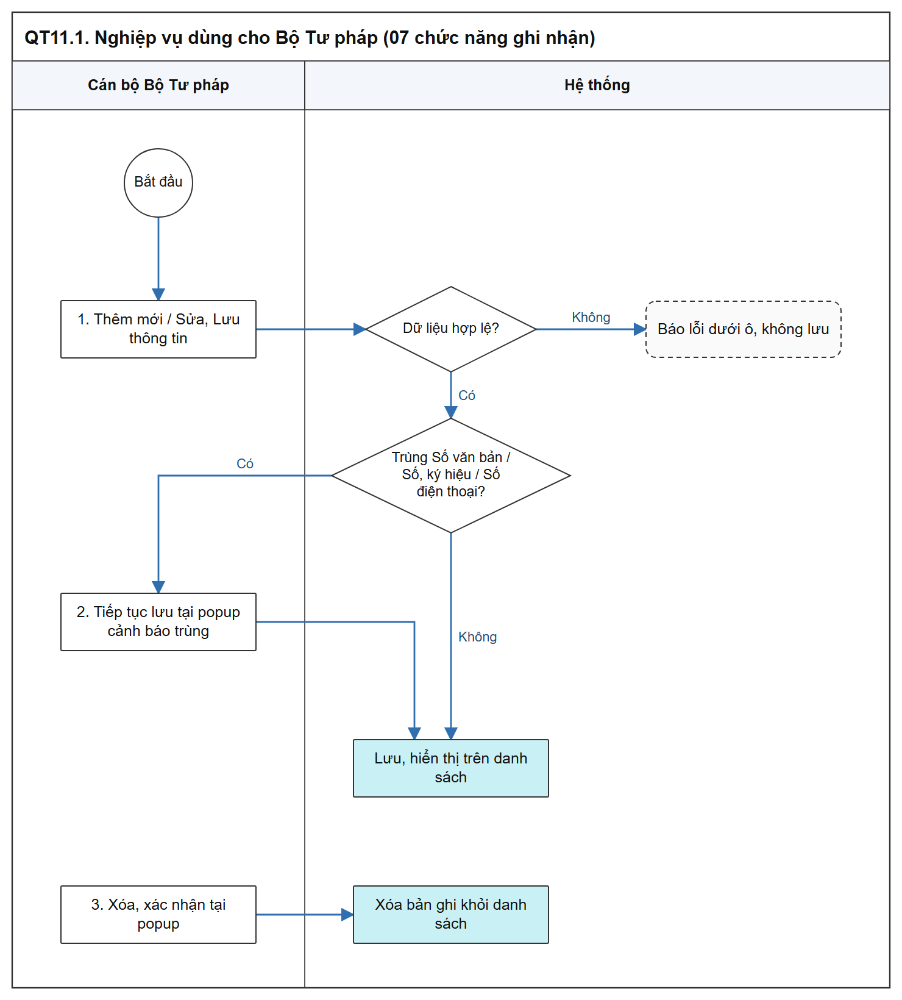

# Nghiệp vụ dùng cho Bộ Tư pháp - Sơ đồ luồng các bước

[Tổng quan - Sơ đồ luồng nghiệp vụ BTNN - Tài liệu tổng hợp](00_Tong_quan_luong_BTNN.md)

## 1. Mục đích và điểm vào

- Cán bộ Bộ Tư pháp (Cục Đăng ký giao dịch bảo đảm và Bồi thường nhà nước) ghi nhận, quản lý, tra cứu thông tin phục vụ quản lý nhà nước; nội dung chỉ nội bộ, không công khai Website khách hàng.
- 07 chức năng cùng mẫu Danh sách - Thêm mới - Sửa - Xóa - Xem chi tiết; không có trạng thái xử lý, không trình ký.
- Menu: `Bồi thường nhà nước` > `Nghiệp vụ dùng cho Bộ Tư pháp`.

| Chức năng | SRS | Mockup | Kiểm tra trùng khi lưu |
| :--- | :--- | :--- | :--- |
| Xây dựng chiến lược, chính sách về công tác BTNN | [Chiến lược, chính sách - Công tác bồi thường nhà nước (Website Quản trị)](../../03_Website_Quan_tri/03_Cong_tac_boi_thuong/SRS_BTNN_BTP_ChienLuoc_ChinhSach.md) | [module=chien_luoc_chinh_sach](https://huyendt2007.github.io/BPBD_UI/UI_Mockup/Website_Quan_tri/03_Boi_thuong_nha_nuoc/quan_ly_nghiep_vu_btnn_muc6.html?module=chien_luoc_chinh_sach) | Số văn bản |
| Ban hành văn bản, biểu mẫu, sổ sách theo thẩm quyền | [Văn bản, biểu mẫu, sổ sách - Công tác bồi thường nhà nước (Website Quản trị)](../../03_Website_Quan_tri/03_Cong_tac_boi_thuong/SRS_BTNN_BTP_VanBan_BieuMau_SoSach.md) | [module=van_ban_bieu_mau_so_sach](https://huyendt2007.github.io/BPBD_UI/UI_Mockup/Website_Quan_tri/03_Boi_thuong_nha_nuoc/quan_ly_nghiep_vu_btnn_muc6.html?module=van_ban_bieu_mau_so_sach) | Số, ký hiệu |
| Hợp tác quốc tế | [Hợp tác quốc tế - Công tác bồi thường nhà nước (Website Quản trị)](../../03_Website_Quan_tri/03_Cong_tac_boi_thuong/SRS_BTNN_BTP_HopTac_QuocTe.md) | [module=hop_tac_quoc_te](https://huyendt2007.github.io/BPBD_UI/UI_Mockup/Website_Quan_tri/03_Boi_thuong_nha_nuoc/quan_ly_nghiep_vu_btnn_muc6.html?module=hop_tac_quoc_te) | - |
| Phối hợp với TAND tối cao, VKSND tối cao | [Phối hợp TAND, VKSND - Công tác bồi thường nhà nước (Website Quản trị)](../../03_Website_Quan_tri/03_Cong_tac_boi_thuong/SRS_BTNN_BTP_PhoiHop_TAND_VKSND.md) | [module=phoi_hop_tand_vksnd](https://huyendt2007.github.io/BPBD_UI/UI_Mockup/Website_Quan_tri/03_Boi_thuong_nha_nuoc/quan_ly_nghiep_vu_btnn_muc6.html?module=phoi_hop_tand_vksnd) | - |
| Giải đáp vướng mắc trong việc áp dụng pháp luật | [Giải đáp vướng mắc - Công tác bồi thường nhà nước (Website Quản trị)](../../03_Website_Quan_tri/03_Cong_tac_boi_thuong/SRS_BTNN_BTP_GiaiDap_VuongMac.md) | [module=giai_dap_vuong_mac](https://huyendt2007.github.io/BPBD_UI/UI_Mockup/Website_Quan_tri/03_Boi_thuong_nha_nuoc/quan_ly_nghiep_vu_btnn_muc6.html?module=giai_dap_vuong_mac) | - |
| Thông tin đầu mối Lãnh đạo, công chức tại địa phương | [Đầu mối cán bộ - Công tác bồi thường nhà nước (Website Quản trị)](../../03_Website_Quan_tri/03_Cong_tac_boi_thuong/SRS_BTNN_BTP_DauMoi_CanBo.md) | [module=dau_moi_btnn](https://huyendt2007.github.io/BPBD_UI/UI_Mockup/Website_Quan_tri/03_Boi_thuong_nha_nuoc/quan_ly_nghiep_vu_btnn_muc6.html?module=dau_moi_btnn) | Số điện thoại |
| Thông tin từ các CSDL có liên quan | [CSDL liên quan - Công tác bồi thường nhà nước (Website Quản trị)](../../03_Website_Quan_tri/03_Cong_tac_boi_thuong/SRS_BTNN_BTP_CSDL_LienQuan.md) | [module=csdl_lien_quan_btnn](https://huyendt2007.github.io/BPBD_UI/UI_Mockup/Website_Quan_tri/03_Boi_thuong_nha_nuoc/quan_ly_nghiep_vu_btnn_muc6.html?module=csdl_lien_quan_btnn) | - |

## 2. Sơ đồ luồng các bước

- Bản SVG để phóng to: [11_1_nghiep_vu_btp.svg](images/11_1_nghiep_vu_btp.svg)

## 3. Bảng các bước

| STT | Người dùng giả lập gợi ý | Màn hình | Thao tác | Kết quả | Tham chiếu SRS |
| :-- | :--- | :--- | :--- | :--- | :--- |
| 1 | `canbonv` | Danh sách | Thêm mới, Lưu thông tin | Bản ghi hiển thị trên danh sách | SRS của chức năng tại mục 1 |
| 2 | `canbonv` | Form | Lưu bản ghi trùng Số văn bản / Số, ký hiệu / Số điện thoại | Popup cảnh báo trùng; `Tiếp tục lưu` thì lưu | SRS Chiến lược, chính sách; Văn bản, biểu mẫu, sổ sách; Đầu mối cán bộ |
| 3 | `canbonv` | Danh sách / Xem chi tiết | Sửa, Xóa | Lưu; Xóa sau xác nhận | SRS của chức năng |

## 4. Trạng thái

- Không có trạng thái xử lý.

## 5. Liên thông

- Không liên thông tự động. Thông tin CSDL liên quan ghi nhận thủ công, không kết nối CSDL nguồn ([CSDL liên quan - Công tác bồi thường nhà nước (Website Quản trị)](../../03_Website_Quan_tri/03_Cong_tac_boi_thuong/SRS_BTNN_BTP_CSDL_LienQuan.md)).

## 6. Điểm cần lưu ý khi kiểm thử

- Cảnh báo trùng không chặn lưu: người dùng được `Tiếp tục lưu` (sơ đồ luồng của 03 SRS có kiểm tra trùng).
- Phân quyền theo từng SRS: cán bộ Bộ Tư pháp tra cứu, xem, thêm, sửa, xóa; quyền của đơn vị khác theo mục Phân quyền của từng SRS.
