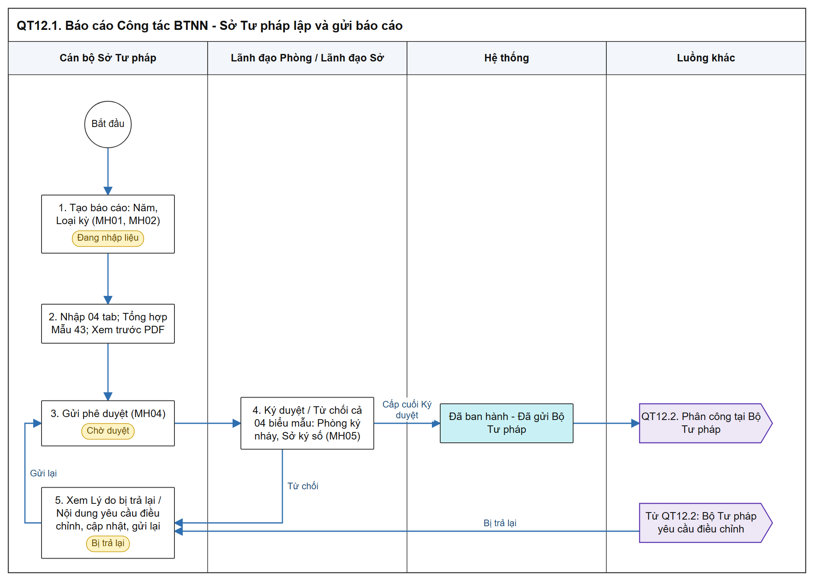
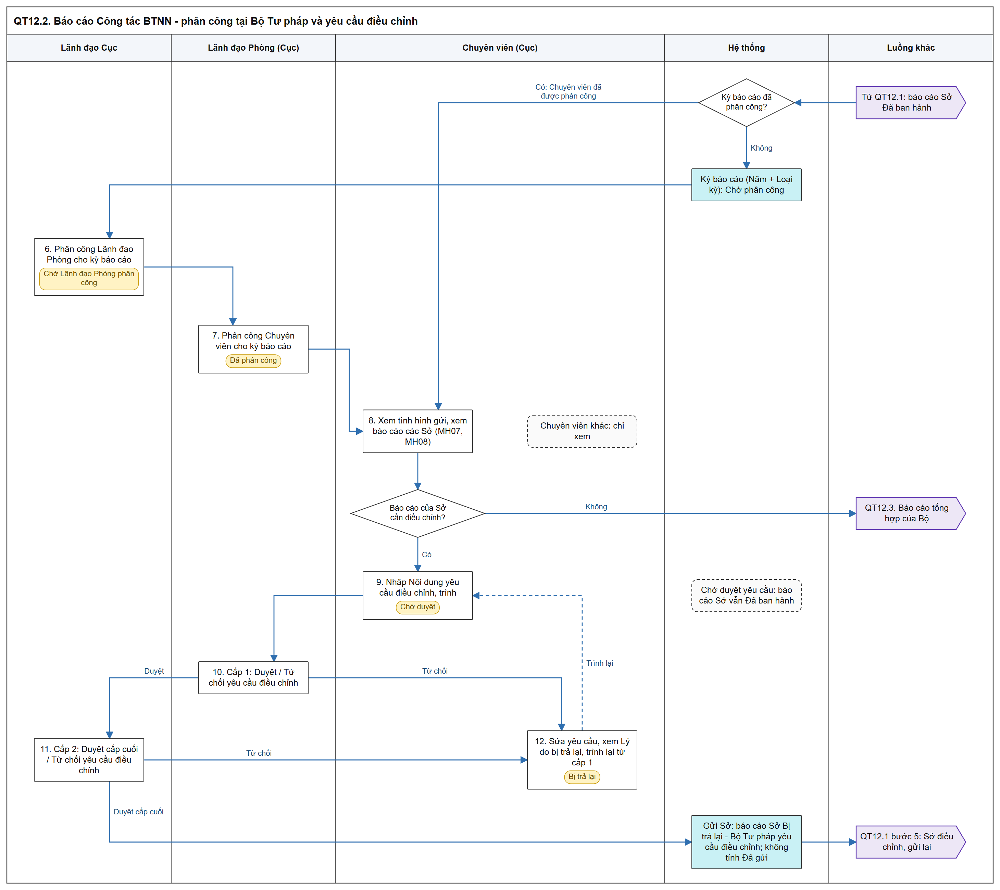
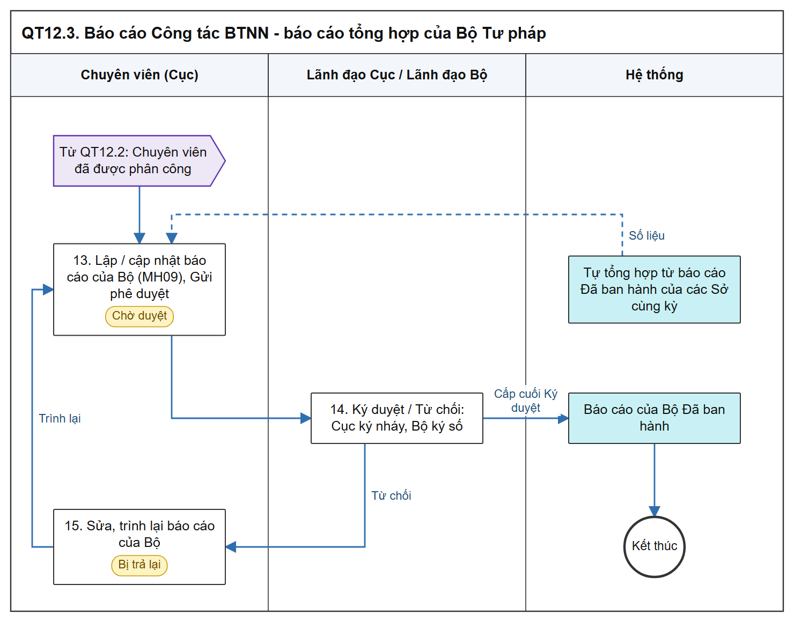

# Báo cáo Công tác BTNN - Sơ đồ luồng các bước

- Luồng phân công tại Bộ Tư pháp và yêu cầu điều chỉnh theo chốt nghiệp vụ ngày 02/11/2026; SRS sẽ cập nhật sau.

[Tổng quan - Sơ đồ luồng nghiệp vụ BTNN - Tài liệu tổng hợp](00_Tong_quan_luong_BTNN.md)

## 1. Mục đích và điểm vào

- Sở Tư pháp lập bộ báo cáo 04 biểu mẫu (Mẫu 41/BTNN, Mẫu 42/BTNN, Mẫu 43/BTNN, Mẫu số 04 (TT 08/2019)), trình ký số 01 lần, gửi Bộ Tư pháp.
- Bộ Tư pháp phân công xử lý theo kỳ báo cáo, theo dõi 34 Sở Tư pháp, yêu cầu Sở điều chỉnh báo cáo, lập báo cáo tổng hợp của Bộ.
- Menu: `Bồi thường nhà nước` > `Báo cáo quản lý BTNN (TT08)` > `Báo cáo Công tác BTNN`.
- Mockup: [bao_cao_cong_tac_btnn.html](https://huyendt2007.github.io/BPBD_UI/UI_Mockup/Website_Quan_tri/03_Boi_thuong_nha_nuoc/bao_cao_cong_tac_btnn.html); mockup chưa hỗ trợ luồng phân công và yêu cầu điều chỉnh (bước 6, 7, 9 - 12).
- SRS: [Báo cáo Công tác BTNN - Công tác bồi thường nhà nước (Website Quản trị)](../../03_Website_Quan_tri/03_Cong_tac_boi_thuong/SRS_BTNN_BaoCao_CongTacBTNN.md).

## 2. Sơ đồ luồng các bước

### 2.1. Sở Tư pháp lập và gửi báo cáo

- Bản SVG để phóng to: [12_1_bao_cao_so.svg](images/12_1_bao_cao_so.svg)

### 2.2. Phân công tại Bộ Tư pháp và yêu cầu điều chỉnh

- Bản SVG để phóng to: [12_2_phan_cong_dieu_chinh.svg](images/12_2_phan_cong_dieu_chinh.svg)

### 2.3. Báo cáo tổng hợp của Bộ Tư pháp

- Bản SVG để phóng to: [12_3_bao_cao_bo.svg](images/12_3_bao_cao_bo.svg)

## 3. Bảng các bước

| STT | Người dùng giả lập gợi ý | Màn hình | Thao tác | Kết quả / Trạng thái sau | Tham chiếu SRS |
| :-- | :--- | :--- | :--- | :--- | :--- |
| 1 | Cán bộ Sở Tư pháp - Đỗ Văn Chung (`bctt_role_v1`) | MH01, MH02 | Tạo báo cáo (Năm, Loại kỳ) | `Đang nhập liệu` | [Báo cáo Công tác BTNN - Công tác bồi thường nhà nước (Website Quản trị)](../../03_Website_Quan_tri/03_Cong_tac_boi_thuong/SRS_BTNN_BaoCao_CongTacBTNN.md) |
| 2 | Như trên | MH03 | Nhập 04 tab; `Tổng hợp` Mẫu 43/BTNN; Xem trước PDF | Tệp `Dự thảo` có nhãn `DỰ THẢO` | [Phạm vi thống kê vụ việc - Báo cáo Công tác BTNN - Công tác bồi thường nhà nước (Website Quản trị)](../../03_Website_Quan_tri/03_Cong_tac_boi_thuong/SRS_BTNN_BaoCao_CongTacBTNN.md#bctt-pham-vi-thong-ke) |
| 3 | Như trên | MH04 | Gửi phê duyệt | `Chờ duyệt` | Cùng SRS |
| 4 | Lãnh đạo Phòng - Vũ Thị Thanh; Lãnh đạo Sở - Phạm Quang Huy (`bctt_role_v1`) | MH05 | Ký duyệt / Từ chối cả 04 biểu mẫu: Lãnh đạo Phòng ký nháy, Lãnh đạo Sở ký số | Cấp cuối: `Đã ban hành`, gửi Bộ Tư pháp; Từ chối: `Bị trả lại` | Cùng SRS |
| 5 | Cán bộ Sở Tư pháp - Đỗ Văn Chung | MH03, MH04 | Xem Lý do bị trả lại (Lãnh đạo Từ chối) hoặc Nội dung yêu cầu điều chỉnh (Bộ Tư pháp), cập nhật, Gửi phê duyệt lại | `Chờ duyệt`; cấp cuối ký: `Đã ban hành`, gửi lại Bộ Tư pháp, đến Chuyên viên đã được phân công | Chốt nghiệp vụ 02/11/2026 |
| 6 | Lãnh đạo Cục - `cuctruong` | Chưa có trên mockup | Phân công Lãnh đạo Phòng cho kỳ báo cáo (Năm + Loại kỳ) | Kỳ báo cáo `Chờ Lãnh đạo Phòng phân công` | Chốt nghiệp vụ 02/11/2026 |
| 7 | Lãnh đạo Phòng - `tpbt` | Chưa có trên mockup | Phân công Chuyên viên cho kỳ báo cáo | Kỳ báo cáo `Đã phân công` | Chốt nghiệp vụ 02/11/2026 |
| 8 | Chuyên viên được phân công - `canbonv` (Chuyên viên khác - `hatt`: chỉ xem) | MH07, MH08, MH03 | Xem tình hình gửi, xem báo cáo của Sở (chỉ đọc) | Không đổi trạng thái | Chốt nghiệp vụ 02/11/2026 |
| 9 | Chuyên viên được phân công - `canbonv` | Chưa có trên mockup | Nhập Nội dung yêu cầu điều chỉnh báo cáo của Sở, trình | Yêu cầu `Chờ duyệt` (cấp 1); báo cáo Sở vẫn `Đã ban hành` | Chốt nghiệp vụ 02/11/2026 |
| 10 | Lãnh đạo Phòng đã phân công kỳ - `tpbt` | Chưa có trên mockup | Cấp 1: Duyệt / Từ chối yêu cầu điều chỉnh (không ký số) | Duyệt: `Chờ duyệt` (cấp 2); Từ chối: `Bị trả lại` | Chốt nghiệp vụ 02/11/2026 |
| 11 | Lãnh đạo Cục đã phân công kỳ - `cuctruong` | Chưa có trên mockup | Cấp 2: Duyệt cấp cuối / Từ chối yêu cầu điều chỉnh (không ký số) | Duyệt: gửi Sở, báo cáo Sở `Bị trả lại` - `Bộ Tư pháp yêu cầu điều chỉnh`, không tính `Đã gửi`; Từ chối: `Bị trả lại` | Chốt nghiệp vụ 02/11/2026 |
| 12 | Chuyên viên được phân công - `canbonv` | Chưa có trên mockup | Xem Lý do bị trả lại, sửa yêu cầu điều chỉnh, trình lại | `Chờ duyệt`, bắt đầu lại từ cấp 1 | Chốt nghiệp vụ 02/11/2026 |
| 13 | Chuyên viên được phân công - `canbonv` | MH09 | Lập / cập nhật báo cáo của Bộ (số liệu tự tổng hợp từ báo cáo Sở `Đã ban hành`), Gửi phê duyệt | `Chờ duyệt` | [Báo cáo tổng hợp của Bộ Tư pháp - Báo cáo Công tác BTNN - Công tác bồi thường nhà nước (Website Quản trị)](../../03_Website_Quan_tri/03_Cong_tac_boi_thuong/SRS_BTNN_BaoCao_CongTacBTNN.md#bctt-btp) |
| 14 | Lãnh đạo Cục - `cuctruong`; Lãnh đạo Bộ - `oanhdh` | MH05 | Ký duyệt / Từ chối báo cáo của Bộ: Lãnh đạo Cục ký nháy, Lãnh đạo Bộ ký số | `Đã ban hành` / `Bị trả lại` | Cùng mục trên |
| 15 | Chuyên viên được phân công - `canbonv` | MH09 | Sửa báo cáo của Bộ `Bị trả lại`, trình lại | `Chờ duyệt` | Cùng mục trên |

## 4. Trạng thái

### 4.1. Báo cáo của Sở Tư pháp / báo cáo của Bộ

| Trạng thái | Ý nghĩa |
| :--- | :--- |
| `Đang nhập liệu` | Đã tạo, chưa trình |
| `Chờ duyệt` | Đã Gửi phê duyệt; dòng phụ `Loại trình: Báo cáo công tác BTNN` và cấp đang chờ |
| `Bị trả lại` | Lãnh đạo Từ chối (dòng phụ Loại trình) hoặc yêu cầu điều chỉnh của Bộ Tư pháp đã duyệt cấp cuối (dòng phụ `Bộ Tư pháp yêu cầu điều chỉnh`, không tính `Đã gửi`) |
| `Đã ban hành` | Lãnh đạo cấp cuối Ký duyệt; dòng phụ `Đã gửi Bộ Tư pháp`; giữ nguyên trong thời gian yêu cầu điều chỉnh chờ duyệt |

### 4.2. Phân công kỳ báo cáo tại Bộ Tư pháp (Năm + Loại kỳ)

| Trạng thái | Ý nghĩa |
| :--- | :--- |
| `Chờ phân công` | Bộ Tư pháp nhận báo cáo đầu tiên của kỳ; chờ Lãnh đạo Cục phân công |
| `Chờ Lãnh đạo Phòng phân công` | Lãnh đạo Cục đã phân công Lãnh đạo Phòng |
| `Đã phân công` | Lãnh đạo Phòng đã phân công Chuyên viên; Chuyên viên xử lý mọi báo cáo Sở của kỳ và báo cáo của Bộ |

### 4.3. Yêu cầu điều chỉnh báo cáo của Sở

| Trạng thái | Ý nghĩa |
| :--- | :--- |
| `Chờ duyệt` | Chuyên viên đã trình; cấp 1 Lãnh đạo Phòng, cấp 2 Lãnh đạo Cục (người đã phân công kỳ) |
| `Bị trả lại` | Lãnh đạo cấp bất kỳ Từ chối; khối `Lý do bị trả lại`; Chuyên viên sửa, trình lại từ cấp 1 |
| Sau duyệt cấp cuối | Yêu cầu gửi Sở Tư pháp; báo cáo Sở chuyển `Bị trả lại` - `Bộ Tư pháp yêu cầu điều chỉnh` |

## 5. Liên thông

| Chiều | Phân hệ | Dữ liệu |
| :--- | :--- | :--- |
| Vào | Giải quyết YCBT, Quyết định GQBT, Kinh phí, Tòa án | Mẫu 43/BTNN tổng hợp tự động; không thống kê vụ việc chỉ có yêu cầu phục hồi danh dự |
| Vào | Báo cáo Sở Tư pháp `Đã ban hành` | Báo cáo đầu tiên của kỳ: khởi tạo kỳ `Chờ phân công`; báo cáo gửi lại sau điều chỉnh: đến Chuyên viên đã được phân công, không phân công lại; số liệu báo cáo của Bộ |
| Ra | Báo cáo Sở Tư pháp | Yêu cầu điều chỉnh đã duyệt cấp cuối: báo cáo Sở `Bị trả lại` - `Bộ Tư pháp yêu cầu điều chỉnh`, kèm Nội dung yêu cầu điều chỉnh |
| Vào | Cấu hình luồng xử lý | Luồng ký Sở Tư pháp (Phòng - Sở), Bộ Tư pháp (Cục - Bộ) |

## 6. Điểm cần lưu ý khi kiểm thử

- Báo cáo Sở và báo cáo của Bộ chỉ `Ký số trên hệ thống`; không có Ký ngoài ([Báo cáo Công tác BTNN - Công tác bồi thường nhà nước (Website Quản trị)](../../03_Website_Quan_tri/03_Cong_tac_boi_thuong/SRS_BTNN_BaoCao_CongTacBTNN.md)).
- Lãnh đạo Phòng, Lãnh đạo Sở không thấy báo cáo `Đang nhập liệu` ([Phạm vi xem và 02 tab - Báo cáo Công tác BTNN - Công tác bồi thường nhà nước (Website Quản trị)](../../03_Website_Quan_tri/03_Cong_tac_boi_thuong/SRS_BTNN_BaoCao_CongTacBTNN.md#bctt-tab-xu-ly)).
- Điều kiện: Sở Tư pháp đã cấu hình luồng; cán bộ lập đã có chữ ký hình ảnh tại Thông tin cá nhân cán bộ (Điều kiện thực hiện của SRS).
- Ô tổng tự tính, chỉ đọc theo công thức cột của Mẫu 43/BTNN, Mẫu số 04 (TT 08/2019); ô tiền có dấu chấm phân cách hàng nghìn (Quy tắc chung của SRS).
- Bộ Tư pháp chỉ tổng hợp báo cáo `Đã ban hành` cùng Năm - Loại kỳ; mỗi cặp Năm - Loại kỳ tối đa 01 báo cáo của Bộ ([Báo cáo tổng hợp của Bộ Tư pháp - Báo cáo Công tác BTNN - Công tác bồi thường nhà nước (Website Quản trị)](../../03_Website_Quan_tri/03_Cong_tac_boi_thuong/SRS_BTNN_BaoCao_CongTacBTNN.md#bctt-btp)).
- Phân công 01 lần cho mỗi kỳ báo cáo, bắt đầu khi nhận báo cáo Sở đầu tiên của kỳ; báo cáo Sở gửi lại sau điều chỉnh không phân công lại.
- Chỉ Chuyên viên được phân công: yêu cầu điều chỉnh, lập / cập nhật / Gửi phê duyệt báo cáo của Bộ; Chuyên viên khác chỉ xem.
- Yêu cầu điều chỉnh: duyệt 02 cấp theo người đã phân công kỳ (Lãnh đạo Phòng → Lãnh đạo Cục), chỉ phê duyệt, không ký số; báo cáo Sở giữ `Đã ban hành` tới khi duyệt cấp cuối.
- Báo cáo Sở `Bị trả lại` - `Bộ Tư pháp yêu cầu điều chỉnh` không tính `Đã gửi`; Sở gửi lại theo luồng Lãnh đạo Phòng ký nháy → Lãnh đạo Sở ký số.
- Mockup chưa hỗ trợ bước 6, 7, 9 - 12 và phân quyền theo Chuyên viên được phân công; kiểm thử theo bảng các bước.
